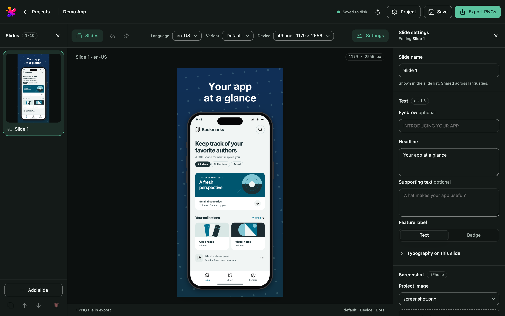

# JamShoot Studio

Compose App Store screenshots from your app screenshots, localized text and a
portable JSON project, in a local browser editor or from the CLI for CI pipelines
and LLM agents.



## Features

- 62 built-in App Store sizes for iPhone, iPhone Duo, iPad and Mac, plus custom sizes.
- Text per language, and variants of the whole set, such as light and dark.
- Layouts, device mockups, gradients, patterns, typography, reusable palettes and layout templates.
- Portable project folders with their own screenshots and fonts; ZIP import and download.
- CLI with JSON output to validate, plan and render, with exit codes for CI.
- One Pillow renderer for preview and export; a manifest with each PNG's SHA-256.
- Runs locally and offline after installation; no Node.js or headless browser.

## Quickstart

Requires Python 3.11 or newer and Git. On macOS or Linux:

```sh
git clone https://github.com/jamshoot-apps/jamshoot-studio.git
cd jamshoot-studio
./studio
```

`./studio` creates `.venv`, installs the dependencies and opens Studio in the
browser. The same environment has the CLI; for Windows or CI, see
[Install](docs/install.md):

```sh
source .venv/bin/activate
jamshoot init ./screenshots
# Replace screenshots/assets/screenshot.png with your app screenshot, then:
jamshoot render ./screenshots/project.json --out ./output --json
```

The package is not published to PyPI. Text uses an installed sans-serif font;
none is bundled. See [Rendering](docs/rendering.md#fonts).

## Documentation

[Install](docs/install.md) · [Studio](docs/studio.md) · [CLI](docs/cli.md) ·
[Project format](docs/project-schema.md) · [Rendering](docs/rendering.md) ·
[Troubleshooting](docs/troubleshooting.md) · [Glossary](docs/glossary.md) ·
[Development](docs/development.md) · [Changelog](CHANGELOG.md)

Report vulnerabilities as described in [SECURITY](SECURITY.md); to propose changes,
see [CONTRIBUTING](CONTRIBUTING.md).

## License

Licensed under [Apache-2.0](LICENSE). Copyright 2026 JamShoot.
The vendored Ionicons SVGs retain their [MIT license](src/jamshoot/web/vendor/ionicons/LICENSE).
Runtime dependencies: jsonschema, Pillow and, for Studio, Bottle.

Apple, App Store, iPhone, iPad and Mac are trademarks of Apple Inc., registered in
the U.S. and other countries. JamShoot Studio is not affiliated with, sponsored or
endorsed by Apple Inc.
