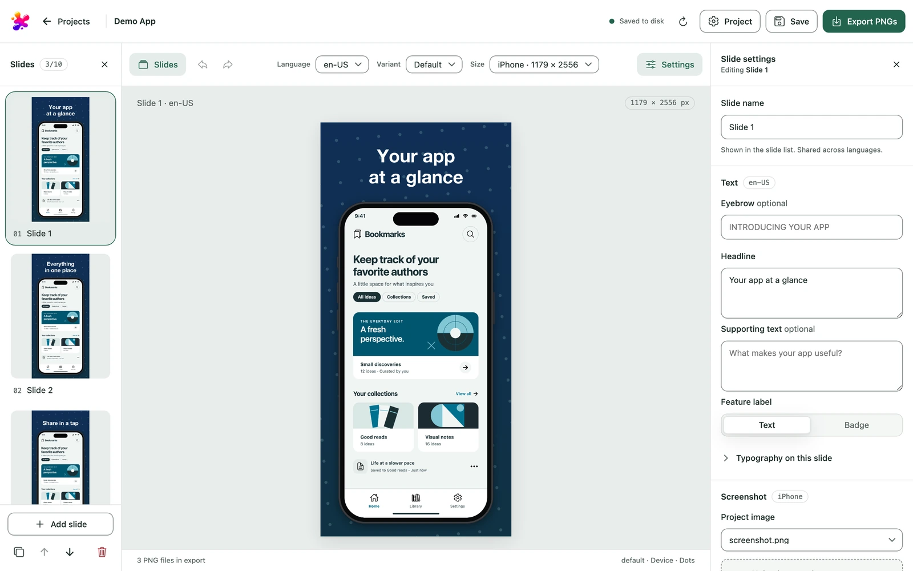

# Studio

Studio is the local browser editor. Start it as described in [Install](install.md)
and open the exact `http://127.0.0.1:PORT` address it prints; `localhost` is
rejected. Ctrl-C in the terminal stops it.



The editor has three areas: the **Slides** panel on the left, the preview in the
middle and **Slide settings** on the right. The **Project** button in the top bar
opens project settings with the tabs **General**, **Layout**, **Typography**,
**Colors**, **Pattern** and **Advanced**. On small screens, the **Slides** and
**Settings** buttons open the side panels.

## Make screenshots

1. On the start screen, choose **New project**, pick iPhone, iPad or Mac and name it.
2. Upload a screenshot in **Slide settings → Screenshot**, or drop it onto the
   preview. Use a static PNG, JPEG or WebP in sRGB, up to 16 MiB. One screenshot
   per platform serves all of that platform's sizes.
3. Write the headline, supporting text and feature label in **Slide settings**, and
   adjust the slide's appearance below them. Add, duplicate, reorder or delete slides
   in the **Slides** panel (1–10 per project).
4. In **Project → General**, add languages, variants, and platforms and sizes. Each
   slide needs a screenshot for every platform you export.
5. Above the preview, **Language**, **Variant** and **Size** choose what you see and
   edit. Export renders every combination.
6. **Save** writes `project.json`. **Export PNGs** renders the current draft,
   including unsaved edits, and shows the output folder. Export does not save.

Preview and export use the same renderer. While an edit renders, the previous image
stays visible; text that does not fit is reported as an error, not clipped.

## Shared settings and slide overrides

Appearance resolves as built-in values → project defaults → variant → slide.
A slide's appearance applies to all its languages and variants; **Reset** removes
the slide's override. Text edits apply to the selected language only.

Reuse colors through palettes in **Project → Colors**, and spacing through layout
templates in **Project → Layout**. Choosing a starter palette copies it into the
project's palettes. Editing a palette or template updates the slides linked to it
and keeps their local overrides; deleting it keeps its values where it was linked.
Spacing and font sizes are stored as percentages; the **% | px** switch shows them
in pixels of the previewed size. Fonts uploaded in **Project → Typography** travel
with the project.

**Project → Advanced → Project JSON** edits the whole configuration. **Apply JSON**
before Save, Export or Undo/Redo; text that fails validation is kept. The
[project format](project-schema.md) explains every field.

## Drafts, files and recovery

Edits are a draft in the browser until **Save**. Reloading or closing the tab
discards unsaved edits; the browser asks first. Undo/Redo holds up to 50 edits and
is cleared on reload. Undo never removes uploaded files or exports.

The Studio folder holds `projects/` and `trash/`; change it in **Settings** on the
start screen. Studio picks it in this order: `--home DIR`, `JAMSHOOT_HOME`, the
saved setting, `--fallback-home DIR`, then `~/JamShoot`. `./studio` falls back to
the cloned folder, so its projects live in `./projects`. `JAMSHOOT_SETTINGS` moves
the settings file.

- Each project is a folder with `project.json` and its `assets/`. **Download .zip**
  on its card packs it with its screenshots and fonts, without exports; **Import
  .zip…** or dropping the file on the start screen adds it back.
- **Remove** moves a project to `trash/`; move the folder back into `projects/` to
  restore it.
- `jamshoot studio path/to/project.json` also opens that project in place for this
  run. Removing it from the list only forgets it.
- Exports go to the project's `exports/export`, then `export-2`, `export-3` and so
  on. `--out DIR` sets the folder for a project opened by path.

```text
exports/export/
  manifest.json
  default/en-US/appstore.iphone.1179x2556/01-overview.png
```

- If Save reports that the file changed on disk, copy your draft's JSON first,
  inspect the file, then reload on purpose: reloading replaces the draft.

Studio is a single-user server bound to `127.0.0.1`. Its API checks Host, Origin
and a per-run token; it is not a hosted service.
